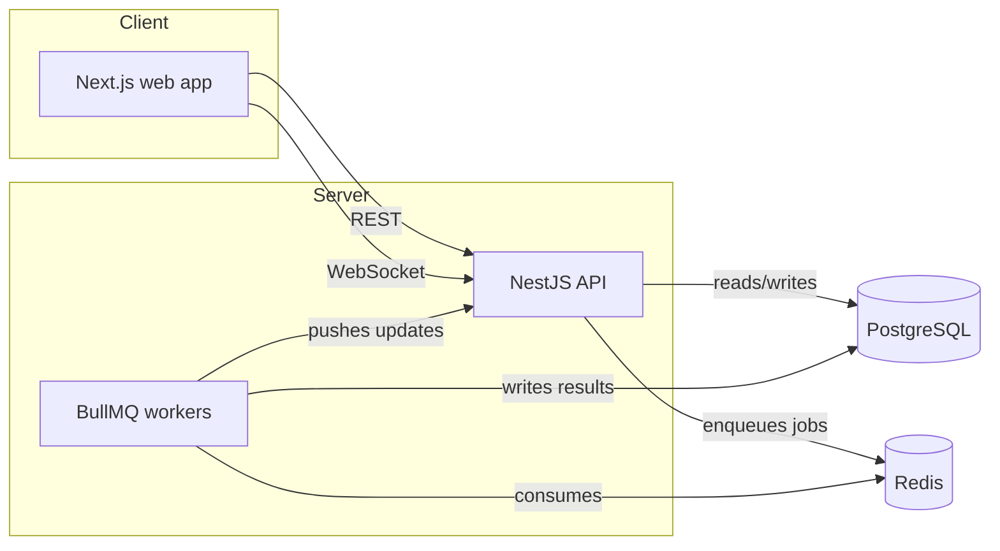

# Architecture — Ashen Contracts

High-level technical overview. The _why_ behind each choice lives in `docs/DECISIONS.md` — this file is the _what_ and _how_.

## System overview



## Repository structure (pnpm workspaces monorepo)

```
apps/
  web/          Next.js frontend (TypeScript)
  api/          NestJS backend (TypeScript)
packages/
  ui/           Shared component library, documented in Storybook
  shared/       Shared types and Zod validation schemas used by both web and api
docs/           Game design, roadmap, architecture, decisions
```

A single repo keeps `apps/web` and `apps/api` in sync on shared types (`packages/shared`) without manual duplication or publishing an internal npm package — see `docs/DECISIONS.md` #002 for the full reasoning.

`packages/shared` is compiled: `tsc` emits ES modules and `.d.ts` files into its `dist/`, and both apps import that build, never its source. The API runs plain `node dist/main` in production, and Node won't run TypeScript from a dependency, so runtime code in the package (constants, validation schemas) has to be JavaScript. The API is CommonJS and loads the ES modules through Node's `require(esm)`, as it does NestJS 12. `pnpm install` builds the package (its `postinstall`), `pnpm dev` rebuilds it on change, and the root `test`, `lint` and `typecheck` scripts rebuild it first, so a pulled change can't leave a stale `dist/` behind them. See `docs/DECISIONS.md` #021.

## Frontend (`apps/web`)

- **Next.js + TypeScript**, styled with Tailwind
- Components consumed from `packages/ui` (`import { Button } from "@ashen-contracts/ui"`) rather than duplicated locally
- Talks to the API over REST through its own route handlers (the BFF, `app/api/`), never from the browser directly. The planned exception is a WebSocket connection (Socket.io client) from the browser to the API for real-time push (e.g. "your training has finished"), authenticated with a short-lived token fetched through the BFF (`docs/DECISIONS.md` #019)

## Component library (`packages/ui`)

- Documented and developed in isolation with **Storybook**
- Published/hosted separately via **Chromatic** so the design system has its own shareable, public link independent of the game itself
- Consumed by `apps/web` as a workspace package (`workspace:*`), not copy-pasted

## Backend (`apps/api`)

- **NestJS** for structure (modules, DI, testability) over a bare Express app
- **PostgreSQL** as the primary data store (players, characters, inventory, world state)
- All time-and-resource-sensitive logic (energy regeneration, skill checks, action costs) is calculated **server-side only** — the client is never trusted with authoritative state (`docs/DECISIONS.md` #003)

### Requests from the BFF and rate limiting

The browser never makes HTTP requests to the API: the Next.js route handlers in `apps/web/app/api/` do (`docs/DECISIONS.md` #005), so the API sees the BFF's address, not the player's. The planned Socket.io connection is the one exception: the browser will connect to the API directly. The API is still publicly reachable, and nothing checks that a request came from the BFF. The JWT guard is its security boundary: every route needs a valid token unless it is marked `@Public()` (`docs/DECISIONS.md` #019). For rate limiting, the BFF forwards the player's IP in `X-Client-IP`, together with `X-BFF-Secret`, which carries the `BFF_SECRET` both apps share. The API trusts the forwarded IP only with a matching secret, and otherwise limits by `req.ip`, which `TRUST_PROXY_HOPS` makes the address the platform proxy saw. Login and register are limited per IP, and login also per email (`@nestjs/throttler`, in-memory counters); see `docs/DECISIONS.md` #017.

### Error responses

Every error the API returns has the body `{ code, message, details? }` (`ApiErrorResponse` in `@ashen-contracts/shared`); the HTTP status is not repeated in it. `code` is an `ApiErrorCode`, which the web app translates (`apps/web/messages/en.json`, checked against the union at compile time); `message` is English for developers. Code throws an `HttpException` with `{ code, message }`. The global `ApiExceptionFilter` (`src/common/errors/apiException.filter.ts`, an `APP_FILTER` in `AppModule`) keeps that code, gives errors thrown without one (Nest's 404 for an unknown route, a malformed JSON body) a generic code from their status, and turns anything unexpected into a 500 `INTERNAL_ERROR`. Every 5xx, a deliberately thrown one included, is answered with a fixed message and no `details`, and the real error is logged. Validation errors are 400 `VALIDATION_FAILED`, with one `details` entry per violated rule (`field`, Zod issue code as `constraint`, `message`). See `docs/DECISIONS.md` #018 and #022.

## Background jobs (Redis + BullMQ)

Any player action with a real-world duration (training, crafting, later: building) is handled as a queued, delayed job rather than a timer trusted to survive in memory:

1. API receives the action request, validates it, enqueues a job with the resolve time
2. A BullMQ worker picks up the job when it's due, applies the result to the database
3. The result is pushed to the client via WebSocket if they're connected, or fetched on next load otherwise

This survives server restarts and scales past a single process — see `docs/DECISIONS.md` #001.

## Real-time (Socket.io)

Used for push notifications only (action completed, event triggered) — not for gameplay-critical state. If a socket connection drops, the client falls back to fetching current state on reconnect/reload, so the game never depends on the socket staying alive.

## Testing

- **Vitest** — unit tests, focused on the logic that actually carries risk: resource math, queue job handlers, skill-check resolution
- **Vitest + supertest** — API integration tests (`apps/api/test/*.integration-spec.ts`, `pnpm --filter api test:integration`): boot the whole NestJS app and send real HTTP requests through guards, pipes and controllers to the database. NestJS templates call these "e2e"; here "e2e" is reserved for browser tests of the full system. Most replace `PrismaService` with an in-memory fake (`test/fakePrisma.ts`), but `GET /health` pings the real database, so they need Postgres running (`docker compose up -d` locally; a `postgres` service container in CI)
- **Playwright** — browser end-to-end tests of the whole system in `apps/e2e`, run with `pnpm test:e2e` (planned, see `docs/DECISIONS.md` #015): the auth flow first, then the core loop (create character → run expedition → resolve event)

## Deployment

| Component                 | Platform                 | Notes                                                                                                                                                                                                                                                                     |
| ------------------------- | ------------------------ | ------------------------------------------------------------------------------------------------------------------------------------------------------------------------------------------------------------------------------------------------------------------------- |
| `apps/web`                | Vercel (free)            | Root Directory set to `apps/web`; Vercel installs from the workspace root so `packages/ui` and `packages/shared` resolve correctly                                                                                                                                        |
| `apps/api`                | Render, free web service | Deployed via Dockerfile (multi-stage build copying required `packages/*`). Health check path: `GET /health` (200, or 503 when the database is unreachable). Spins down after 15 minutes without traffic and takes up to about a minute to wake (`docs/DECISIONS.md` #020) |
| PostgreSQL                | Prisma Postgres (free)   | Reached over TCP through `@prisma/adapter-pg`; 500 MB and a monthly operation quota                                                                                                                                                                                       |
| Redis                     | Not chosen yet           | Required by BullMQ from v0.4; must persist data and fit BullMQ's polling within a free plan's quota (#020)                                                                                                                                                                |
| `packages/ui` (Storybook) | Chromatic                | Separate public link, independent of the game deployment                                                                                                                                                                                                                  |

## Local development

`docker-compose.yml` runs PostgreSQL and Redis in containers, so `pnpm dev` works end-to-end without installing either service. The apps themselves run on the host. Ports are bound to `127.0.0.1` only, and the data lives in named volumes (`docker compose down -v` wipes it). Redis runs with AOF persistence and `maxmemory-policy noeviction`, as BullMQ requires. Setup steps: README, "Getting started locally".
